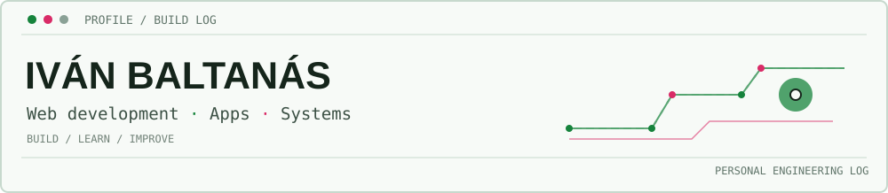

  <picture>
    <source media="(prefers-color-scheme: dark)" srcset="./assets/build-log-dark.svg">
    
  </picture>

  <a href="https://www.linkedin.com/in/iv%C3%A1n-baltan%C3%A1s-ortiz-a93416276/">LinkedIn</a> ·
  <a href="mailto:ivabalta@gmail.com">Email</a> ·
  <a href="mailto:blondcoder@gmail.com">Alternate email</a>

## About Me

I'm an ICT student and developer drawn to the places where web development, mobile apps, and systems meet. I enjoy building useful things, understanding how they work under the hood, and learning through projects that touch both software and infrastructure.

My main career focus is web development, while application development, Linux, networking, and cybersecurity keep me curious outside the browser. I have also gained practical experience with full-stack development and IT systems; employer-specific work is intentionally left out here.

## Stack

| Area | Technologies |
| --- | --- |
| Web | HTML, CSS, JavaScript, TypeScript, React, Tailwind CSS, PHP |
| Backend & APIs | Node.js, Express, REST APIs, Prisma |
| Data | PostgreSQL, MySQL, SQL, JSON, XML |
| Mobile | Kotlin, Android, Room |
| Systems & networking | Linux, Windows, Docker, Bash, PowerShell, Wireshark, WireGuard, Vagrant |
| Also explored | Python, C, C++, C#/.NET, Arduino, Kubernetes, Git, GitHub Actions |

## Selected Builds

### StarStats · Tennis data, made easier to explore

**Problem** — Player information and competition statistics are easier to use when they can be searched and compared in one place.

**Build** — A full-stack tennis statistics app with a React interface, Express/TypeScript API, PHP scraping endpoints, and MySQL/MariaDB. Its source selection depends on retirement status: retired athletes are served from the database; active athletes are looked up through Wikipedia scraping.

**Outcome** — Player search and athlete cards alongside competition-based comparisons.

[Explore StarStats](https://github.com/theblondcoder/StarStats)

### Smart Fire Detection · An embedded safety prototype

**Problem** — Fire and smoke need to be noticed quickly, including when sensor readings are monitored remotely.

**Build** — An ESP32-based sensing prototype connected to a local dashboard, with a web interface for monitoring and alerts.

**Outcome** — A working prototype that brings embedded sensing and a live monitoring dashboard together. Deployment and access details are intentionally not published.

[Explore the project](https://github.com/theblondcoder/alarm-smart-tech-public)

### Training Diary · A focused workout log

**Problem** — Keeping a consistent view of workouts and progress should not require a complicated fitness platform.

**Build** — A native Android app built with Kotlin and Room for locally stored workout tracking.

**Outcome** — A focused base for recording training and reviewing progress. **Still in development:** cloud database support, caching, notifications, and further improvements are planned, not yet presented as completed features.

[Explore the project](https://github.com/theblondcoder/training-diary-app-public)

### Home Lab · Learning by running my own services

**Problem** — I wanted a hands-on place to learn about Linux, storage, containers, networking, and self-hosted software.

**Build** — A personal home server environment using OpenMediaVault and Docker, with storage redundancy, self-hosted services, and private VPN-based remote administration.

**Outcome** — A modular, running lab for experimenting with infrastructure and automation. Hostnames, network layout, endpoints, and access configuration are deliberately omitted.

## Currently Building

The Training Diary is actively evolving. Cloud database integration, caching, notifications, and other improvements are in progress or planned; the repository README is the source of truth for the current implementation status.

<!-- PUBLIC-ACTIVITY:START -->
## Public Activity

_The public activity snapshot will appear here after the profile updater runs._
<!-- PUBLIC-ACTIVITY:END -->

## Find Me

[LinkedIn · Iván Baltanás](https://www.linkedin.com/in/iv%C3%A1n-baltan%C3%A1s-ortiz-a93416276/) · [ivabalta@gmail.com](mailto:ivabalta@gmail.com) · [blondcoder@gmail.com](mailto:blondcoder@gmail.com)

Building across the stack, one useful experiment at a time.

