<picture>
  <source media="(max-width: 600px) and (prefers-color-scheme: dark)" srcset="./assets/workstation-mobile-dark.svg">
  <source media="(max-width: 600px)" srcset="./assets/workstation-mobile-light.svg">
  <source media="(prefers-color-scheme: dark)" srcset="./assets/workstation-dark.svg">
  
</picture>

<p align="center">
  <a href="#01--about-me">01 / About</a> &nbsp;·&nbsp;
  <a href="#02--toolchain">02 / Stack</a> &nbsp;·&nbsp;
  <a href="#03--build-files">03 / Builds</a> &nbsp;·&nbsp;
  <a href="#04--activity">04 / Activity</a> &nbsp;·&nbsp;
  <a href="#05--open-a-channel">05 / Connect</a>
</p>

## 01 / About Me

**Web development is my focus. Understanding what runs underneath it keeps me curious.**

I'm Iván, an ICT student specialising in application development at **Thomas More, Belgium**. I build web and Android apps, and keep a personal home lab running to learn about Linux, containers, networking and self-hosting.

My route into tech includes a higher technical degree in web application development, a full-stack internship and hands-on IT systems experience. I like projects where an interface, an API and the system behind them have to work together.

```yaml
developer:
  handle: theblondcoder
  main_quest: web development
  side_quests: [apps, automation, systems, cybersecurity]
  learning_mode: build → break → understand → improve
```

**Currently on the workbench:** Training Diary, with cloud data, caching and notifications on the development roadmap.

<details>
<summary><b>Experience, without the confidential bits</b></summary>

- **Full-stack internship:** React and Tailwind interfaces, Node.js/Express REST APIs, PostgreSQL and Prisma, authentication, business logic and teamwork with Git.
- **IT systems experience:** maintaining computers, servers and networks, plus scripting to automate recurring tasks.
- **Security mindset:** cybersecurity coursework and an ongoing interest in understanding how systems are configured, connected and protected.

Employer work stays private. No company, client or supplier names, internal code or operational data are published here.

</details>

## 02 / Toolchain

<picture>
  <source media="(max-width: 600px) and (prefers-color-scheme: dark)" srcset="./assets/toolchain-mobile-dark.svg">
  <source media="(max-width: 600px)" srcset="./assets/toolchain-mobile-light.svg">
  <source media="(prefers-color-scheme: dark)" srcset="./assets/toolchain-dark.svg">
  
</picture>

**Project building blocks:** HTML · CSS · JavaScript · TypeScript · React · Tailwind CSS · PHP · Node.js · Express · REST APIs · SQL · PostgreSQL · MySQL/MariaDB · Prisma · Kotlin · Android · Room · Git/GitHub.

<details>
<summary><b>Open the extended toolkit</b> / coursework, projects and systems practice</summary>

**Languages & formats** / Python · Bash · PowerShell · C · C++ · C#/.NET · JSON · XML

**Infrastructure** / Linux · Windows · Docker · Kubernetes · Vagrant · VirtualBox · VMware · GitHub Actions

**Networking & tools** / Wireshark · WireGuard · Cisco console · PuTTY · Arduino

These are technologies I've used or explored through study, projects and practical experience, not a claim of equal expertise in every tool.

</details>

## 03 / Build Files

### StarStats / Choosing the Right Source

<a href="https://github.com/theblondcoder/StarStats">
  <picture>
    <source media="(max-width: 600px) and (prefers-color-scheme: dark)" srcset="./assets/starstats-mobile-dark.svg">
    <source media="(max-width: 600px)" srcset="./assets/starstats-mobile-light.svg">
    <source media="(prefers-color-scheme: dark)" srcset="./assets/starstats-dark.svg">
    
  </picture>
</a>

<details>
<summary><b>StarStats / readable project notes</b></summary>

**The problem:** tennis information is easier to explore when players and competition statistics can be searched and compared in one place.

**What I built:** a React interface, an Express/TypeScript API, PHP scraping endpoints and MySQL/MariaDB storage. The app makes a source decision for each athlete: **retired → database; active → Wikipedia scraping.**

**The result:** player search, athlete cards and competition-based comparisons, with data retrieval adapted to the athlete's status.

</details>

<a href="https://github.com/theblondcoder/StarStats" title="Explore the StarStats repository">
  <picture>
    <source media="(prefers-color-scheme: dark)" srcset="./assets/starstats-repository-dark.svg">
    
  </picture>
</a>

### Smart Fire Detection / From Sensor to Signal

<a href="https://github.com/theblondcoder/alarm-smart-tech-public">
  <picture>
    <source media="(max-width: 600px) and (prefers-color-scheme: dark)" srcset="./assets/fire-mobile-dark.svg">
    <source media="(max-width: 600px)" srcset="./assets/fire-mobile-light.svg">
    <source media="(prefers-color-scheme: dark)" srcset="./assets/fire-dark.svg">
    
  </picture>
</a>

<details>
<summary><b>Smart Fire Detection / readable project notes</b></summary>

**The problem:** sensing a possible fire is only useful if the readings can be monitored and an alert can be surfaced.

**What I built:** an ESP32-based sensing prototype paired with a Node.js/Express monitoring dashboard.

**The result:** embedded sensing and web monitoring in one working prototype. This is a learning project, not a certified fire-safety system. Deployment credentials and access details are not part of the public repository.

</details>

<a href="https://github.com/theblondcoder/alarm-smart-tech-public" title="Explore the Smart Fire Detection repository">
  <picture>
    <source media="(prefers-color-scheme: dark)" srcset="./assets/fire-repository-dark.svg">
    
  </picture>
</a>

### Training Diary / An App Under Construction

<a href="https://github.com/theblondcoder/training-diary-app-public">
  <picture>
    <source media="(max-width: 600px) and (prefers-color-scheme: dark)" srcset="./assets/diary-mobile-dark.svg">
    <source media="(max-width: 600px)" srcset="./assets/diary-mobile-light.svg">
    <source media="(prefers-color-scheme: dark)" srcset="./assets/diary-dark.svg">
    
  </picture>
</a>

> [!IMPORTANT]
> **ACTIVELY IN DEVELOPMENT.** Cloud database integration, caching, notifications and more improvements are being developed or planned. They are not all completed features.

<details>
<summary><b>Training Diary / readable project notes</b></summary>

**The problem:** keeping track of training should be straightforward, without the overhead of a complicated fitness platform.

**What I built:** a native Android app in Kotlin, using Room to store workout records locally.

**The result so far:** a focused base for recording workouts and reviewing progress. The next stage explores cloud-backed data and a more connected app experience.

</details>

<a href="https://github.com/theblondcoder/training-diary-app-public" title="Follow the Training Diary repository">
  <picture>
    <source media="(prefers-color-scheme: dark)" srcset="./assets/diary-repository-dark.svg">
    
  </picture>
</a>

### Home Lab / Learning by Keeping It Running

<picture>
  <source media="(max-width: 600px) and (prefers-color-scheme: dark)" srcset="./assets/lab-mobile-dark.svg">
  <source media="(max-width: 600px)" srcset="./assets/lab-mobile-light.svg">
  <source media="(prefers-color-scheme: dark)" srcset="./assets/lab-dark.svg">
  
</picture>

<details>
<summary><b>Home Lab / readable project notes</b></summary>

**The problem:** I wanted my own place to experiment with Linux, storage, networking and containers beyond a classroom exercise.

**What I built:** a Raspberry Pi home NAS using OpenMediaVault, redundant storage and Docker-based self-hosted services, alongside scripts for personal automation.

**The result:** a running, modular lab that grows as I discover new tools. Private cloud storage, media management, DNS filtering and home automation all give me practical reasons to keep learning.

</details>

<details>
<summary><b>Inside the software toolbox</b> / not the network configuration</summary>

OpenMediaVault · Docker · Nextcloud · Immich · SWAG · Pi-hole · Home Assistant · Obsidian · WireGuard

The graphic above is conceptual. Addresses, hostnames, ports, credentials, service URLs and remote-access configuration stay private. This project is not published as a code repository.

</details>

<!-- PUBLIC-ACTIVITY:START -->
## 04 / Activity

<picture>
  <source media="(max-width: 600px) and (prefers-color-scheme: dark)" srcset="./assets/activity-mobile-dark.svg">
  <source media="(max-width: 600px)" srcset="./assets/activity-mobile-light.svg">
  <source media="(prefers-color-scheme: dark)" srcset="./assets/activity-dark.svg">
  
</picture>

<sub>140 contributions · 32 active days · current streak: 1 day · longest streak: 2 days. As shown publicly through 2026-10-13.</sub>

<picture>
  <source media="(max-width: 600px) and (prefers-color-scheme: dark)" srcset="./assets/activity-grid-mobile-dark.svg">
  <source media="(max-width: 600px)" srcset="./assets/activity-grid-mobile-light.svg">
  <source media="(prefers-color-scheme: dark)" srcset="./assets/activity-grid-dark.svg">
  
</picture>

### Recent Updates

- `2026-10-10` / **CREATED** / [alarm-smart-tech-public](https://github.com/theblondcoder/alarm-smart-tech-public)
- `2026-10-10` / **CODE PUSHED** / [StarStats](https://github.com/theblondcoder/StarStats)
- `2026-10-10` / **CREATED** / [StarStats](https://github.com/theblondcoder/StarStats)

<details>
<summary><b>Public repository index</b> / auto-discovered</summary>

| Repository | Last push (UTC) |
| --- | --- |
| [training-diary-app-public](https://github.com/theblondcoder/training-diary-app-public) | 2026-10-12 |
| [alarm-smart-tech-public](https://github.com/theblondcoder/alarm-smart-tech-public) | 2026-10-10 |
| [StarStats](https://github.com/theblondcoder/StarStats) | 2026-10-10 |

[All public repositories](https://github.com/theblondcoder?tab=repositories&type=public)

</details>

<sub>Updated every six hours. Calendar counts are read anonymously from the public GitHub profile; they may include anonymised private contributions if you enable that setting. No private repository names, code or access details are read. Recent updates use public events only. All dates use UTC.</sub>
<!-- PUBLIC-ACTIVITY:END -->

## 05 / Open a Channel

<a href="https://www.linkedin.com/in/iv%C3%A1n-baltan%C3%A1s-ortiz-a93416276/">
  <picture>
    <source media="(max-width: 600px) and (prefers-color-scheme: dark)" srcset="./assets/connect-mobile-dark.svg">
    <source media="(max-width: 600px)" srcset="./assets/connect-mobile-light.svg">
    <source media="(prefers-color-scheme: dark)" srcset="./assets/connect-dark.svg">
    
  </picture>
</a>

[LinkedIn / Iván Baltanás](https://www.linkedin.com/in/iv%C3%A1n-baltan%C3%A1s-ortiz-a93416276/) &nbsp;·&nbsp; [ivabalta@gmail.com](mailto:ivabalta@gmail.com) &nbsp;·&nbsp; [blondcoder@gmail.com](mailto:blondcoder@gmail.com)

---

<p align="center"><sub>Built with curiosity. Maintained with GitHub Actions.</sub></p>
