<picture>
  <source media="(max-width: 600px) and (prefers-color-scheme: dark)" srcset="./assets/workstation-mobile-dark.svg">
  <source media="(max-width: 600px)" srcset="./assets/workstation-mobile-light.svg">
  <source media="(prefers-color-scheme: dark)" srcset="./assets/workstation-dark.svg">
  
</picture>

<p align="center">
  <a href="#01--about-me">01 / About</a> &nbsp;·&nbsp;
  <a href="#02--toolchain">02 / Stack</a> &nbsp;·&nbsp;
  <a href="#03--build-files">03 / Builds</a> &nbsp;·&nbsp;
  <a href="#04--activity">04 / Activity</a> &nbsp;·&nbsp;
  <a href="#05--open-a-channel">05 / Connect</a>
</p>

## 01 / About Me

**I'm Iván Baltanás, a web developer with a passion for building applications and understanding the systems behind them.**

**Web development is my main focus**, and I also develop **desktop and Android applications**. I enjoy connecting interfaces, APIs and databases to turn an idea into something useful. Beyond development, I'm an enthusiast of **IT systems, cybersecurity and networking**: I want to understand how software runs, communicates and can be secured.

### Education / The Route So Far

- **`2025 - Present` / Bachelor in Information and Communication Technologies**<br>
  Specialisation in **App Development** · Thomas More University, Sint-Katelijne-Waver, Belgium · **In progress**
- **`2024 - 2025` / Specialisation Course in Cybersecurity in Information Technology Environments**<br>
  IES El Cañaveral, Móstoles, Madrid, Spain
- **`2022 - 2024` / Higher Technician in Web Application Development**<br>
  IES José Luis Sampedro, Tres Cantos, Madrid, Spain
- **`2020 - 2022` / High School Graduate**<br>
  IES José Luis Sampedro, Tres Cantos, Madrid, Spain

<details>
<summary><b>Academic highlights & English</b></summary>

- Highest average grade in my web development cohort: **8/10**.
- Final web development project: **8/10**.
- Duolingo English certificate: **110 (Advanced B2)**.

</details>

That curiosity continues outside the classroom. I run a **Raspberry Pi NAS and self-hosted services lab**, experiment with Linux, containers and networks, and develop personal projects to put what I learn into practice. I like learning by building, testing and understanding how all the pieces fit together.

```yaml
developer:
  handle: theblondcoder
  main_quest: web development
  side_quests: [desktop, Android, systems, cybersecurity, networks]
  learning_mode: build → break → understand → improve
```

## 02 / Toolchain

These are technologies I've used or explored through study, projects and practical experience, not a claim of equal expertise in every tool.

<picture>
  <source media="(max-width: 600px) and (prefers-color-scheme: dark)" srcset="./assets/toolchain-mobile-dark.svg">
  <source media="(max-width: 600px)" srcset="./assets/toolchain-mobile-light.svg">
  <source media="(prefers-color-scheme: dark)" srcset="./assets/toolchain-dark.svg">
  
</picture>

## 03 / Build Files

### StarStats / Choosing the Right Source

<a href="https://github.com/theblondcoder/StarStats">
  <picture>
    <source media="(max-width: 600px) and (prefers-color-scheme: dark)" srcset="./assets/starstats-mobile-dark.svg">
    <source media="(max-width: 600px)" srcset="./assets/starstats-mobile-light.svg">
    <source media="(prefers-color-scheme: dark)" srcset="./assets/starstats-dark.svg">
    
  </picture>
</a>

<a href="https://github.com/theblondcoder/StarStats" title="Explore the StarStats repository">
  <picture>
    <source media="(prefers-color-scheme: dark)" srcset="./assets/starstats-repository-dark.svg">
    
  </picture>
</a>

### Smart Fire Detection / From Sensor to Signal

<a href="https://github.com/theblondcoder/alarm-smart-tech-public">
  <picture>
    <source media="(max-width: 600px) and (prefers-color-scheme: dark)" srcset="./assets/fire-mobile-dark.svg">
    <source media="(max-width: 600px)" srcset="./assets/fire-mobile-light.svg">
    <source media="(prefers-color-scheme: dark)" srcset="./assets/fire-dark.svg">
    
  </picture>
</a>

<a href="https://github.com/theblondcoder/alarm-smart-tech-public" title="Explore the Smart Fire Detection repository">
  <picture>
    <source media="(prefers-color-scheme: dark)" srcset="./assets/fire-repository-dark.svg">
    
  </picture>
</a>

### Training Diary / An App Under Construction

<a href="https://github.com/theblondcoder/training-diary-app-public">
  <picture>
    <source media="(max-width: 600px) and (prefers-color-scheme: dark)" srcset="./assets/diary-mobile-dark.svg">
    <source media="(max-width: 600px)" srcset="./assets/diary-mobile-light.svg">
    <source media="(prefers-color-scheme: dark)" srcset="./assets/diary-dark.svg">
    
  </picture>
</a>

> [!IMPORTANT]
> **ACTIVELY IN DEVELOPMENT.** Cloud database integration, caching, notifications and more improvements are being developed or planned. They are not all completed features.

<a href="https://github.com/theblondcoder/training-diary-app-public" title="Follow the Training Diary repository">
  <picture>
    <source media="(prefers-color-scheme: dark)" srcset="./assets/diary-repository-dark.svg">
    
  </picture>
</a>

### Home Lab / Learning by Keeping It Running

<picture>
  <source media="(max-width: 600px) and (prefers-color-scheme: dark)" srcset="./assets/lab-mobile-dark.svg">
  <source media="(max-width: 600px)" srcset="./assets/lab-mobile-light.svg">
  <source media="(prefers-color-scheme: dark)" srcset="./assets/lab-dark.svg">
  
</picture>

<details>
<summary><b>Inside the software toolbox</b> / not the network configuration</summary>

OpenMediaVault · Docker · Nextcloud · Immich · SWAG · Pi-hole · Home Assistant · Obsidian · WireGuard

The graphic above is conceptual. Addresses, hostnames, ports, credentials, service URLs and remote-access configuration stay private. This project is not published as a code repository.

</details>

<!-- PUBLIC-ACTIVITY:START -->
## 04 / Activity

<picture>
  <source media="(max-width: 600px) and (prefers-color-scheme: dark)" srcset="./assets/activity-mobile-dark.svg">
  <source media="(max-width: 600px)" srcset="./assets/activity-mobile-light.svg">
  <source media="(prefers-color-scheme: dark)" srcset="./assets/activity-dark.svg">
  
</picture>

<sub>142 contributions · 33 active days · current streak: 1 day · longest streak: 2 days. As shown publicly through 2026-10-14.</sub>

<picture>
  <source media="(max-width: 600px) and (prefers-color-scheme: dark)" srcset="./assets/activity-grid-mobile-dark.svg">
  <source media="(max-width: 600px)" srcset="./assets/activity-grid-mobile-light.svg">
  <source media="(prefers-color-scheme: dark)" srcset="./assets/activity-grid-dark.svg">
  
</picture>

### Recent Updates

- `2026-10-12` / **CREATED** / [training-diary-app-public](https://github.com/theblondcoder/training-diary-app-public)
- `2026-10-10` / **CREATED** / [alarm-smart-tech-public](https://github.com/theblondcoder/alarm-smart-tech-public)
- `2026-10-10` / **CODE PUSHED** / [StarStats](https://github.com/theblondcoder/StarStats)

<details>
<summary><b>Public repository index</b> / auto-discovered</summary>

| Repository | Last push (UTC) |
| --- | --- |
| [training-diary-app-public](https://github.com/theblondcoder/training-diary-app-public) | 2026-10-12 |
| [alarm-smart-tech-public](https://github.com/theblondcoder/alarm-smart-tech-public) | 2026-10-10 |
| [StarStats](https://github.com/theblondcoder/StarStats) | 2026-10-10 |

[All public repositories](https://github.com/theblondcoder?tab=repositories&type=public)

</details>

<sub>Updated every six hours. Calendar counts are read anonymously from the public GitHub profile; they may include anonymised private contributions if you enable that setting. No private repository names, code or access details are read. Recent updates use public events only. All dates use UTC.</sub>
<!-- PUBLIC-ACTIVITY:END -->

## 05 / Open a Channel

<a href="https://www.linkedin.com/in/iv%C3%A1n-baltan%C3%A1s-ortiz-a93416276/">
  <picture>
    <source media="(max-width: 600px) and (prefers-color-scheme: dark)" srcset="./assets/connect-mobile-dark.svg">
    <source media="(max-width: 600px)" srcset="./assets/connect-mobile-light.svg">
    <source media="(prefers-color-scheme: dark)" srcset="./assets/connect-dark.svg">
    
  </picture>
</a>

<a href="https://www.linkedin.com/in/iv%C3%A1n-baltan%C3%A1s-ortiz-a93416276/" title="Contact Iván on LinkedIn"><picture><source media="(prefers-color-scheme: dark)" srcset="./assets/contact-linkedin-dark.svg"></picture></a>
<a href="mailto:ivabalta@gmail.com" title="Contact ivabalta@gmail.com"><picture><source media="(prefers-color-scheme: dark)" srcset="./assets/contact-primarymail-dark.svg"></picture></a>
<a href="mailto:blondcoder@gmail.com" title="Contact blondcoder@gmail.com"><picture><source media="(prefers-color-scheme: dark)" srcset="./assets/contact-codermail-dark.svg"></picture></a>

---

<p align="center"><sub>Built with curiosity. Maintained with GitHub Actions.</sub></p>
